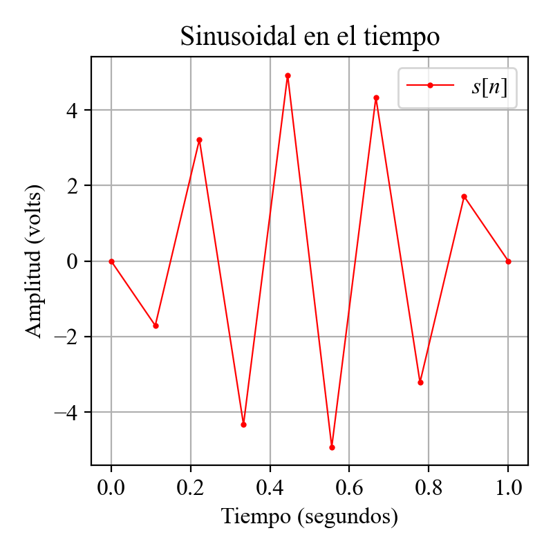
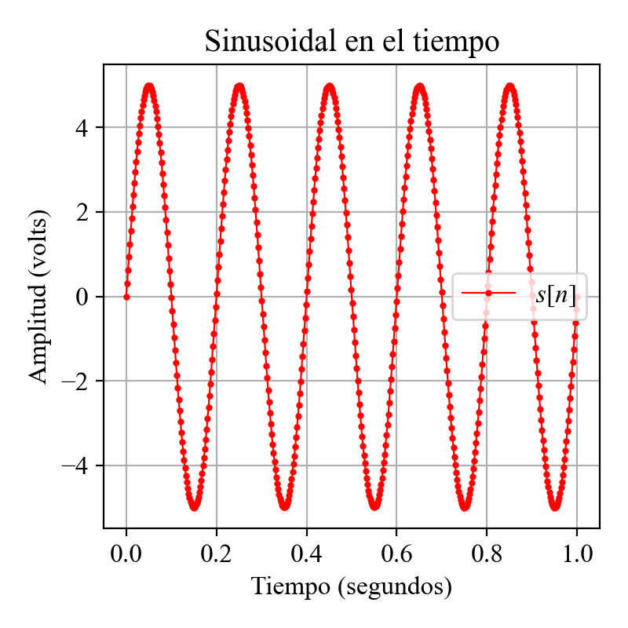
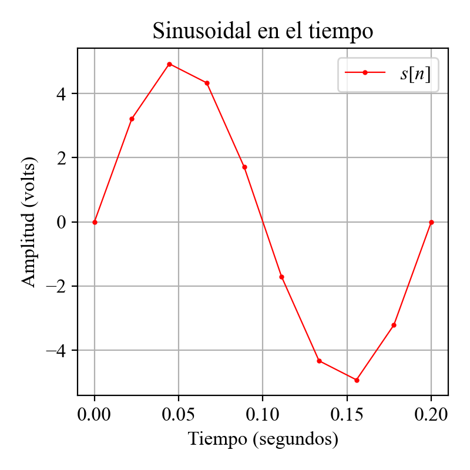

# Simulación de señales en tiempo real usando Python - Blog 1 - Digitalización y espacios muestrales

Una forma simple y accesible de aprender a utilizar señales y a visualizarlas en tiempo real es mediante la programación en Python. Este lenguaje de programación nos ofrece una serie de librerías útiles para el desarrollo de esta actividad, tales como numpy, scipy y matplotlib. El entendimiento de cómo se realiza la visualización de las señales nos permite, a su vez, comprender cómo funcionan los sistemas electrónicos de sensado y de comunicaciones.

El aprendizaje de estas metodologías puede desarrollarse en ambas direcciones: primero, aprender cómo se realiza la digitalización de las señales analógicas obtenidas de un transductor en un dispositivo electrónico; o, en la dirección opuesta, entender cómo se realiza la simulación de las señales en el plano digital, donde se debe crear un espacio muestral para luego obtener las señales a partir de modelos matemáticos simulando el entorno físico estudiado.

## Señales en el tiempo

Como primer ejemplo, estudiaremos el gráfico de una señal sinusoidal utilizando un espacio muestral generado por nosotros. Esta problemática base nos llevará al análisis de la frecuencia de muestreo y de los parámetros relacionados con la frecuencia, fase y amplitud de la señal generada.

### Instalación y configuración del entorno de programación

Primero debemos instalar Python en nuestro computador. Para los efectos prácticos de esta demostración, no utilizaremos entornos como Spyder o Anaconda debido a que agregan por defecto librerías que no se utilizarán y que, para efectos de rendimiento, resulta más efectivo y liviano realizar las simulaciones directamente con Python en la terminal o IDLE. Debido a que su instalación es genérica, puedes encontrar los pasos para instalarlo en el siguiente enlace ["Instala Python"](https://cimtt.cl/people/raul-zamorano-illanes/instala-python-anexo-1/).

Luego de instalar Python, se debe revisar si la instrucción "python" o "python3" ha sido añadida al PATH del computador, en cualquiera de los sistemas operativos. De esta manera la palabra pasará a formar parte de los comandos aceptados por la terminal que se utilizará, ya sea la terminal de Ubuntu o Mac, o "cmd" en Windows. El formato en el que trabajaremos permitirá ejecutar cualquier archivo .py que generemos directamente de la terminal, la cual ejecutará el programa utilizando todas las librerías instaladas para la instancia utilizada.

En el caso de que se prefiera generar environments para ejecutar diferentes versiones de librerías que se acomoden mejor a las necesidades de la programación que se quiera realizar, se recomienda entender cómo funciona la librería "python environments" ([venv](https://docs.python.org/3/library/venv.html)). De esta manera se puede "encapsular" toda la información relacionada a librerías y a la versión de Python a utilizar en un solo directorio.


### Gráfica de una señal en un espacio muestral determinado

En primer lugar, importaremos las librerías y generaremos un espacio muestral, el cual definiremos como una variable ("n") utilizando la función linspace de NumPy. De esta manera podemos generar un arreglo de números secuencialmente utilizando los parámetros "start", "stop" y "num", siguiendo las especificaciones de la función "np.linspace" que podemos encontrar en la documentación de la librería: [np.linspace](https://numpy.org/doc/stable/reference/generated/numpy.linspace.html).

La ecuación que utilizaremos para guiar nuestro análisis en relación al tiempo y asociándolo con la frecuencia de oscilación será la siguiente:

$$
s(t) = A \cdot \mathrm{sin}(2 \pi ft+\phi),
$$

donde $A$ es la amplitud máxima y mínima que la señal modelada obtendrá cuando la función sinusoidal resulte en 1 o -1 respectivamente, $f$ representa la frecuencia temporal medida en Hertz (Hz), que representa la cantidad de oscilaciones completas por unidad de tiempo que la función realizará, $t$ representará el tiempo en el que nos encontremos y con el que podremos calcular el valor de amplitud correspondiente a ese instante y $\phi$ es el desfase medido en radianes que la señal tendrá con respecto a lo que la señal sinusoidal en su forma original presentaría, de esta manera cuando $\phi = 0 \hspace{0.1cm}\mathrm{rad}$, la señal sinusoidal tendrá un valor 0 de amplitud, caso contrario al de la función cosenoidal. Es importante hacer hincapié en este término, debido a que en comunicaciones la fase representa un parámetro clave en los procesos de sincronización y coherencia de los sistemas utilizados.

Debido a que estamos trabajando sobre un espacio muestral $n$, la expresión puede cambiar a:

$$
s[n] = A \cdot \mathrm{sin}(2 \pi fn+\phi),
$$

simplemente porque se trata de una señal discreta, donde $s[n]$ representará el vector con el conjunto de valores de amplitud obtenidos en los diferentes instantes de tiempo contenidos en el espacio $n$. Esta representación es idealizada, y se debe tener en cuenta en sistemas eléctricos reales que el proceso de digitalización de una señal en el tiempo puede ser realizado de diferentes formas de acuerdo al diseño electrónico del digitalizador (ADC) utilizado.  

Pasando al código en Python, tenemos el siguiente análisis:


```python
# Importamos las librerías
import numpy as np

# Definimos la extensión temporal de nuestro espacio muestral
t_ini = 0 #seg
t_fin = 1 #seg

# Definimos N como la cantidad de valores que contendrá el espacio muestral
N = 10

# Definimos las variables que utilizaremos en nuestro modelo
A = 5 #Volts
f = 5 #Hz
phi = 0 #rad

# Definimos el espacio muestral con todas las variables previamente definidas
n = np.linspace(t_ini,t_fin,N)

# Calculamos los valores de amplitud relacionados al modelo de señal presentado para cada punto obtenido en el espacio muestral n
s = A*np.sin(2*np.pi*f*n+phi)

print("=======================\n Espacio muestral\n=======================\n n = ", n);
print("=======================\n Valores de amplitud\n=======================\n s = ", s);
```

Al ejecutar este comando deberíamos obtener lo siguiente:
```python
=======================
 Espacio muestral
=======================
 n =  [0.         0.11111111 0.22222222 0.33333333 0.44444444 0.55555556
 0.66666667 0.77777778 0.88888889 1.        ]
=======================
 Valores de amplitud
=======================
 s =  [ 0.00000000e+00 -3.42020143e-01  6.42787610e-01 -8.66025404e-01
  9.84807753e-01 -9.84807753e-01  8.66025404e-01 -6.42787610e-01
  3.42020143e-01 -1.22464680e-15]
```

De esta manera hemos obtenido dos vectores, uno con los valores de tiempo y otro con los valores de amplitud asociados a la función sinusoidal que hemos definido. Ahora graficaremos estos valores en un gráfico de dos dimensiones usando la librería matplotlib:

```python
# Importamos las librerías
import matplotlib.pyplot as plt

# Definimos que se utilizará la fuente times new roman y su tamaño en las figuras:
plt.rcParams.update({
    "font.family": "Times New Roman",
    "mathtext.fontset": "custom",
    "mathtext.rm": "Times New Roman",
    "mathtext.it": "Times New Roman:italic",
    "mathtext.bf": "Times New Roman:bold",
    "mathtext.fallback": "stix",
    "font.size": 12,
})

# Definimos la figura en la cual dibujaremos nuestros gráficos, su tamaño y densidad de puntos por pulgada
plt.figure(1,figsize=(4,4),dpi=200)

# Graficamos la señal especificando los dos vectores, el color de la línea, el tipo de marcador utilizado para cada punto, el tamaño del marcador, el grosor de la línea y el nombre de la curva
plt.plot(n,s, c="red", marker='o', markersize=2, linestyle='-', linewidth=0.8, label=r"$s[n]$")

# Especificamos el título de la figura y los nombres de los ejes utilizados
plt.title("Sinusoidal en el tiempo")
plt.xlabel("Tiempo (segundos)")
plt.ylabel("Amplitud (volts)")

# Activamos la rejilla de la gráfica
plt.grid()

# Mostramos los nombres de las curvas en una caja
plt.legend()

# Ajustamos los componentes ya posicionados para que no se sobrepongan
plt.tight_layout()

# Graficamos y abrimos el canvas de la figura en la que estamos trabajando
plt.show()
```

El output que deberíamos obtener de este código será:



Es en este punto que podemos observar que la señal no es la que esperábamos: una sinusoidal de 5 ciclos por segundo. Esto se debe a que no hemos considerado una cantidad suficiente de muestras para ese periodo de tiempo de acuerdo a la señal que queremos graficar, parámetro que definiremos como frecuencia de muestreo. En otras palabras, cuántas muestras por unidad de tiempo necesito para representar mi señal de forma íntegra. Para solucionar este problema, debido a que hemos definido las variables al inicio de nuestro código, solo nos basta cambiar la línea en que definimos la cantidad de muestras a considerar:

```python
# Definimos N como la cantidad de valores que contendrá el espacio muestral
N = 500
```

Con lo que ya podremos obtener una señal de un muestreo aceptable, permitiéndonos visualizar la cantidad de ciclos y la amplitud esperadas:



El entendimiento de la frecuencia de muestreo resulta fundamental para el correcto registro de los fenómenos naturales que se quieran registrar a partir de la señal eléctrica de un transductor. Este tema se abordará luego en una segunda instancia en más detalle. Por el momento, seguiremos la regla de utilizar 10 veces más muestras que la frecuencia temporal de la señal que se requiera graficar. En este caso, debido a que $f = 5$ Hz, utilizaremos una frecuencia de muestreo $f_s = 50$ muestras/s, que en el tiempo de un ciclo de oscilación sinusoidal, en este caso nos dará un $t_{max} = 1/5 = 0.2$ s, representará una cantidad $N = 50/5 = 10$ muestras, obteniendo la siguiente gráfica:



Esta regla, como se puede observar, varía la calidad de la señal que queremos simular, y se aplica a su vez a los sistemas que digitalizan señales desde el mundo real. Es importante ser conscientes de las limitaciones de los sistemas al momento de registrar los cambios y a su vez de qué tan rápido son capaces los sistemas de almacenar o transmitir esta información en sus subsistemas. Si estamos registrando una señal a una tasa de 1 Tera muestras por segundo, es probable que el almacenamiento, transporte y visualización de las señales se transforme en un proceso inviable y requiera de capacidades de un computador costoso a la fecha (2026), sin embargo, si la señal que queremos visualizar contiene componentes de frecuencias principales del orden los kilo Hertz, no es necesario un muestreo tan demandante, y se puede tomar la decisión tanto de realizar un submuestreo, como de realizar la digitalización a una menor tasa de muestras por segundo, y es entonces cuando el cálculo presentado anteriormente nos permite calcular cuál es el límite que podemos alcanzar. Esto permitirá procesos más ligeros y en muchos casos permitirá la visualización en tiempo real de los procesos de procesamiento digital de señales.

El teorema de Whittaker-Nyquist-Kotelnikov-Shannon-etc, usualmente conocido como el teorema de Nyquist. Harry Nyquist trabajaba en AT&T estudiando sistemas de transmisión de información en pares de cobre. Básicamente podemos resumir sus estudios más en relación a la transmisión de información en banda base, por lo que nos da el pie para explicar una distinción importante que no se suele hacer al estudiar esta teoría, y es que es importante entender qué es lo que deseamos registrar desde nuestra señal, si se trata de una reconstrucción a máxima resolución de un fenómeno físico, ya sea una imagen en la mejor resolución posible, o una señal el en tiempo que tiene información valiosa sobre un fenómeno astronómico, etc, quizás lo mejor que se puede hacer es encontrar la manera de registrarla a la mayor tasa de muestreo posible, debido a que luego podemos postprocesarla y estudiarla detalladamente y entender a mayor detalle y estudiando una mayor cantidad de componentes de frecuencia; por el contrario, si lo que queremos es una señal de información transmitida a través de un medio, probablemente nos baste con estudiar, de acuerdo al tipo de modulación utilizada y a las técnicas de sincronización requeridas, la tasa de sobremuestreo requerida o en inglés "Over Sampling Ratio (OSR)", que para el caso de Nyquist, en una señal sincronizada correspondía a dos veces la frecuencia de una señal de dos estados lógicos en una comunicación por par de cobre de ciertas características de impedancia. Los estudios de Nyquist se pueden encontrar actualmente en el repositorio de la IEEE.

[Certain factors affecting telegraph speed](https://ieeexplore.ieee.org/document/6773395)

[Certain Topics in Telegraph Transmission Theory](https://ieeexplore.ieee.org/document/5055024)

Es por esto que el criterio de elegir nuestra tasa de muestreo resulta fundamental.

### Cálculo / obtención de chunks de señal para su visualización

Bajo esta perspectiva, realizaremos en Python una simulación que nos permitirá visualizar en tiempo real una señal simulada a través del tiempo y nos dará una visión de cómo se comportan las señales, especialmente las señales clásicas estudiadas en la electricidad analógica, como lo son las señales sinusoidales, cuadradas, dientes de sierra, etc.

Debido a que las computadoras funcionan en relación a estructuras de datos, que almacenan en unidades de memoria, lo más efectivo es trabajar en relación a estas entidades luego serán transferidas a diferentes entidades e interfaces dedicadas para ser transformadas en imagen o algún tipo de señal de salida que el usuario podrá interpretar fuera del computador a través de alguno de los periféricos o transductores y que se actualizarán constantemente. Dependiendo de los dispositivos utilizados, se requerirá el uso de ciertos dimensiones para las estructuras de datos entrantes, los que usualmente son compatibilizados por los programas usualmente llamados "drivers", que compatibilizan el firmware presente el en hardware a utilizar con las interfaces presentes en el dispositivo interconectado.

En el siguiente código se presenta una aproximación a este análisis, en donde la misma señal presentada anteriormente se calcula en relación a un segmento de tiempo que variará a través de las iteraciones, calculando solo una sección de la señal modelada, y estableciendo el largo de la estructura de datos a utilizar. Para esto se utilizará la función "animation" de la librería "Matplotlib", la cual actualizará la ```Fig``` de acuerdo a los parámetros de:
- ```funcion```: La cadena de instrucciones que se ejecutará cíclicamente
- ```interval```: En tiempo que durará cada frame de la gráfica simulada
- ```blit```: Se pregunta si se puede optimizar el proceso, a veces esto impacta en la gráfica, especialmente si se quiere cambiar el tamaño de la ventana que contiene a la figura, pero usualmente hace el proceso más liviano para el computador.
- ```cache_frame_data```: Guarda los frames producidos por la función animación en la RAM, por lo que el usuario puede usar frames históricos para mostrarlos, por ejemplo, en una pantalla secundaria.

En este caso, como se presenta a continuación, las dos últimas funciones descritas no se utilizarán:

```python
ani = FuncAnimation(
    fig,
    funcion,
    interval=RefreshTime,
    blit=False,
    cache_frame_data=False
)
```

Siguiendo la estructura ya descrita anteriormente debemos incluir ciertas variables globales de nuestra simulación para poder realizar el cálculo de cada chunk:

```python
# Intervalo de actualización de la animacion en mili segundos. 
RefreshTime=30 # Si este tiempo es similar al tiempo de refresco de la pantalla, probablemente la grafica se visualizara de mejor manera.

# Numero de muestras por chunk calculado de acuerdo a el tiempo de refresh
N = int(fs*RefreshTime/1000)

# Si la senal es demasiado rapida y los chunks muy largos, es probable que sea conveniente establecer este valor manualmente.
#N = 10

# Numero maximo de chunks visibles
N_Chunk_per_display = 20

# Duración de la ventana temporal (segundos)
t_ventana = N_Chunk_per_display * N / fs

...
from collections import deque
...

# ==============================================
# BUFFERS CICLICOS
# ==============================================

# Estas variables permiten actualizar los chunks calculados en las graficas.
t_chunks = deque(maxlen=N_Chunk_per_display)
s_chunks = deque(maxlen=N_Chunk_per_display)
...

```

Con estos valores podemos hacer el cálculo cíclicamente de la sección de señal correspondiente a cada chunk y asociarla con la sección de señal que se graficará en el programa:

```python
def funcion(frame):

    # Generamos N nuevas muestras temporales
    n = (frame * N + np.arange(N)) / fs

    # Calculamos las amplitudes del nuevo chunk
    s = A * np.sin(2 * np.pi * f * n + phi)

    # Incorporamos el nuevo chunk a los buffers
    t_chunks.append(n)
    s_chunks.append(s)

    # Concatenamos los chunks disponibles
    t_buffer = np.concatenate(t_chunks)
    s_buffer = np.concatenate(s_chunks)

    # Actualizamos los datos de la curva
    line.set_data(t_buffer, s_buffer)

    # Calculamos el espacio de tiempo actual
    t_actual = n[-1] + 1 / fs

    # Actualizamos la ventana temporal
    ax.set_xlim(
        max(0, t_actual - t_ventana),
        max(t_ventana, t_actual)
    )
    return line,
```

Todas las acciones concatenadas se presentan en el siguiente código:


```python

import numpy as np
import matplotlib.pyplot as plt
from matplotlib.animation import FuncAnimation
from collections import deque

A = 5       # Amplitud (volts)
f = 5       # Frecuencia (Hz)
phi = 0     # Fase (radianes)
fs = 100
RefreshTime=30 # Si este tiempo es similar al tiempo de refresco de la pantalla, probablemente la grafica se visualizara de mejor manera.
N = int(fs*RefreshTime/1000)
N_Chunk_per_display = 20
t_ventana = N_Chunk_per_display * N / fs

plt.rcParams.update({
    "font.family": "Times New Roman",
    "mathtext.fontset": "custom",
    "mathtext.rm": "Times New Roman",
    "mathtext.it": "Times New Roman:italic",
    "mathtext.bf": "Times New Roman:bold",
    "mathtext.fallback": "stix",
    "font.size": 12,
})

fig, ax = plt.subplots(figsize=(7, 4), dpi=120)
line, = ax.plot(
    [], [],
    c="red",
    marker="o",
    markersize=2,
    linestyle="-",
    linewidth=0.8,
    label=r"$s[n]$"
)

ax.set_title("Sinusoidal en el tiempo")
ax.set_xlabel("Tiempo (segundos)")
ax.set_ylabel("Amplitud (volts)")
ax.set_xlim(0, t_ventana)
ax.set_ylim(-A * 1.2, A * 1.2)
ax.grid(True)
ax.legend(loc="upper right")

t_chunks = deque(maxlen=N_Chunk_per_display)
s_chunks = deque(maxlen=N_Chunk_per_display)

def funcion(frame):
    n = (frame * N + np.arange(N)) / fs
    s = A * np.sin(2 * np.pi * f * n + phi)
    t_chunks.append(n)
    s_chunks.append(s)
    t_buffer = np.concatenate(t_chunks)
    s_buffer = np.concatenate(s_chunks)
    line.set_data(t_buffer, s_buffer)
    t_actual = n[-1] + 1 / fs

    ax.set_xlim(
        max(0, t_actual - t_ventana),
        max(t_ventana, t_actual)
    )
    return line,

ani = FuncAnimation(
    fig,
    funcion,
    interval=RefreshTime,
    blit=False,
    cache_frame_data=False
)

plt.tight_layout()
plt.show()

```

Al cambiar el valor de $f_s$ de 10 a 100 a 1000, etc; se puede corroborar cómo el proceso se vuelve más demandante en recursos para el computador, sin embargo, para la visualización de la señal en cuestión, puede resultar ser suficiente. De igual manera, si se está estudiando una señal de frecuencia de muestreo alta, siempre se cuenta con la posibilidad de graficar una sección pequeña de los datos que permita el estudio de la señal y la gráfica, por ejemplo del espectro de frecuencias de Fourier a través del tiempo en un rango de frecuencias suficiente, ejecutando una visualización fluida en el sistema utilizado, pero que no corresponderá a la velocidad real de la señal registrada, sin embargo permitirá visualizar un fenómeno particular a una escala de tiempo perceptible por el usuario.


## Señales en el dominio de la frecuencia

Un análisis común dentro de nuestra área es la transformada de Fourier, este tema será abordado con más detalle en otra publicación, sin embargo la utilización de esta herramienta resulta fundamental para el entendimiento de técnicas del área de las telecomunicaciones, tales como la modulación, filtrado, interferencia, etc. Para la implementación de la teoría de Fourier en dispositivos que han registrado las señales eléctricas ya en el dominio discreto se presenta la transformada rápida o "Fast Fourier Transform (FFT)" como la implementación más utilizada a nivel industrial. A través de iteraciones, este método permite el cálculo de la transformada discreta de Fourier o "Discrete Fourier Transform (DFT)", a través de una serie de operaciones ya optimizadas.

Para el cálculo de las componentes de frecuencias y fase se realiza el siguiente 

$$
X[ k] = \sum_{n=0}^{N-1}x[n]e^{\frac{-j2\pi kn}{N}}
$$

donde $N$ es el número de muestras del chunk, $x[n]$ es el chunk como tal para la muestra $n$, que se verá influenciada por el término exponencial, el cual es complejo. Este cálculo nos dará como resultado un vector en otro espacio muestral $X[k]$ el cual deberemos analizar para obtener las componentes de fase y frecuencia.

Para obtener el espectro de magnitudes se calcula el módulo del vector complejo obtenido. En este caso si consideramos que la componente real e imaginaria del valor complejo $X[k]$ son representados por $a_k$ y $b_k$ respectivamente, el cálculo del espectro de magnitudes corresponderá a:

$$
FFT_{\mathrm{M}} = |X[k]| = \sqrt{a_k^2+b_k^2}
$$

mientras que la fase se obtiene desde:

$$
FFT_{\mathrm{\phi}} = arg(X[k]) = \mathrm{tan}^{-1}(\frac{b_k}{a_k})
$$

Luego debemos inferir los valores de frecuencia asociados, agrupados en un vector como:

$$
f_k = \frac{kf_s}{N}
$$

Al realizar estos cálculos, nos damos cuenta de que en realidad son solo vectores y operaciones, por lo que para el computador, ya con las funciones optimizadas, no debe ser un cálculo demasiado exigente si se realiza sobre un chunk de muestras acotado, sin embargo, como podemos inferir del cálculo del espacio de frecuencias asociado, la relación entre $f_s$ y $N$ dictará el valor de $f_\mathrm{max}$ que podamos obtener, indiferente de $t_\mathrm{max}$ en nuestro experimento o simulación.

A continuación se presenta un código en Python para la obtención de la FFT mediante la utilización de las librerías mencionadas anteriormente. La descripción en detalle de este proceso, así como el impacto de la cuantización sobre el proceso descrito, se realizarán en una futura publicación. Por el momento, al ejecutar este programa, el usuario será capaz de modificar variables generales como $f_s$ y $N$, así como otros relacionados a la interfaz de visualización, como por ejemplo el tiempo de refresco de la pantalla.


```Python
from collections import deque

import numpy as np
import matplotlib.pyplot as plt
from matplotlib.animation import FuncAnimation
from matplotlib.colors import LinearSegmentedColormap
from matplotlib.widgets import Button, Slider, TextBox

A = 5.0
f = 5.0
phi = 0.0
forma_onda = "Sinusoidal"

fs = 300.0
N = 300
refresh_ms = 10
N_Chunk_per_display = 2
f_max_plot = 30.0

TIEMPO_Y_MIN = -12.0
TIEMPO_Y_MAX = 12.0
MAGNITUD_Y_MIN = -80.0
MAGNITUD_Y_MAX = 24.0
FASE_Y_MIN = -np.pi
FASE_Y_MAX = np.pi

mostrar_fase_de_baja_magnitud = True

T_chunk = N / fs
T_ventana = N_Chunk_per_display * T_chunk
frecuencias = np.fft.rfftfreq(N, d=1.0 / fs)
df = fs / N

tiempo_cursor = 0.0
fase_portadora = 0.0

plt.rcParams.update({
    "font.family": "Times New Roman",
    "mathtext.fontset": "custom",
    "mathtext.rm": "Times New Roman",
    "mathtext.it": "Times New Roman:italic",
    "mathtext.bf": "Times New Roman:bold",
    "mathtext.fallback": "stix",
    "font.size": 11,
})

fig, axs = plt.subplots(2, 2, figsize=(12, 9.5), dpi=120)
ax_t, ax_mag = axs[0, 0], axs[0, 1]
ax_fase, ax_wf = axs[1, 0], axs[1, 1]
fig.suptitle("Análisis dinámico de señal por chunks", fontsize=14)
fig.subplots_adjust(left=0.09, right=0.94, bottom=0.40,
                    top=0.91, wspace=0.35, hspace=0.45)
if fig.canvas.manager is not None:
    fig.canvas.manager.set_window_title("Simulador: señal, FFT y waterfall")

(line_t,) = ax_t.plot([], [], color="red", marker="o", markersize=2,
                      linewidth=1.0, label=r"$s[n]$")
ax_t.set(title=f"Señal temporal — {forma_onda}", xlabel="Tiempo (s)",
         ylabel="Amplitud (V)")
ax_t.set_xlim(0, T_ventana)
ax_t.set_ylim(TIEMPO_Y_MIN, TIEMPO_Y_MAX)
ax_t.grid(True, color="black", alpha=0.18)
ax_t.legend(loc="upper right")

(line_mag,) = ax_mag.plot(frecuencias, np.full_like(frecuencias, MAGNITUD_Y_MIN),
                          color="red", marker="o", markersize=3, linewidth=1.0)
ax_mag.set(title="Espectro de magnitud (FFT del chunk)",
           xlabel="Frecuencia (Hz)", ylabel="Magnitud (dBV)")
ax_mag.set_xlim(0, min(f_max_plot, fs / 2))
ax_mag.set_ylim(MAGNITUD_Y_MIN, MAGNITUD_Y_MAX)
ax_mag.grid(True, color="black", alpha=0.18)

(line_fase,) = ax_fase.plot(
    frecuencias, np.full_like(frecuencias, np.nan),
    linestyle="-", linewidth=1.0, color="black",
    marker="o", markerfacecolor="red", markeredgecolor="black", markersize=4,
)
ax_fase.set(title="Espectro de fase (FFT del chunk)",
            xlabel="Frecuencia (Hz)", ylabel="Fase (rad)")
ax_fase.set_xlim(0, min(f_max_plot, fs / 2))
ax_fase.set_ylim(FASE_Y_MIN, FASE_Y_MAX)
ax_fase.set_yticks([-np.pi, -np.pi / 2, 0, np.pi / 2, np.pi])
ax_fase.set_yticklabels([r"$-\pi$", r"$-\pi/2$", "0", r"$\pi/2$", r"$\pi$"])
ax_fase.grid(True, color="black", alpha=0.18)

DB_MIN = -80.0
DB_MAX = 20.0
cmap = LinearSegmentedColormap.from_list("negro_rojo", ["black", "red"])
im_wf = ax_wf.imshow(
    np.full((N_Chunk_per_display, len(frecuencias)), DB_MIN),
    origin="lower", aspect="auto", interpolation="nearest",
    cmap=cmap, vmin=DB_MIN, vmax=DB_MAX,
    extent=[-df / 2, frecuencias[-1] + df / 2, -T_ventana, 0],
)
ax_wf.set(title="Waterfall de magnitudes", xlabel="Frecuencia (Hz)",
          ylabel="Tiempo relativo (s)")
ax_wf.set_xlim(0, min(f_max_plot, fs / 2))
fig.colorbar(im_wf, ax=ax_wf, label="Magnitud (dBV)", fraction=0.046, pad=0.04)

t_chunks = deque(maxlen=N_Chunk_per_display)
s_chunks = deque(maxlen=N_Chunk_per_display)
espectros_db = deque(maxlen=N_Chunk_per_display)


FORMAS_ONDA = ("Sinusoidal", "Cuadrada", "Diente de sierra", "Triangular")
BOTON_ACTIVO = "#a80000"
BOTON_INACTIVO = "#222222"


def generar_onda(angulos, amplitud, tipo):
    if tipo == "Sinusoidal":
        base = np.sin(angulos)
    elif tipo == "Cuadrada":
        base = np.where(np.mod(angulos, 2 * np.pi) < np.pi, 1.0, -1.0)
    elif tipo == "Diente de sierra":
        fraccion = np.mod(angulos / (2 * np.pi) + 0.5, 1.0)
        base = 2.0 * fraccion - 1.0
    elif tipo == "Triangular":
        base = (2.0 / np.pi) * np.arcsin(np.sin(angulos))
    else:
        raise ValueError(f"Forma de onda no reconocida: {tipo}")
    return amplitud * base


botones_onda = {}
for i, nombre in enumerate(FORMAS_ONDA):
    ax_boton = fig.add_axes([0.135 + i * 0.195, 0.287, 0.175, 0.047])
    boton = Button(
        ax_boton, nombre,
        color=BOTON_ACTIVO if nombre == forma_onda else BOTON_INACTIVO,
        hovercolor="#bf3232",
    )
    boton.label.set_color("white")
    boton.label.set_fontsize(10)
    botones_onda[nombre] = boton


def seleccionar_onda(tipo):
    global forma_onda
    forma_onda = tipo
    for nombre, boton in botones_onda.items():
        color = BOTON_ACTIVO if nombre == tipo else BOTON_INACTIVO
        boton.color = color
        boton.ax.set_facecolor(color)
    ax_t.set_title(f"Señal temporal — {tipo}")
    fig.canvas.draw_idle()


for nombre, boton in botones_onda.items():
    boton.on_clicked(lambda _event, tipo=nombre: seleccionar_onda(tipo))

ax_slider_phi = fig.add_axes([0.24, 0.210, 0.49, 0.027])
ax_slider_f = fig.add_axes([0.24, 0.150, 0.49, 0.027])
ax_slider_A = fig.add_axes([0.24, 0.090, 0.49, 0.027])

slider_phi = Slider(ax_slider_phi, r"Fase $\phi$ (rad)", -np.pi, np.pi,
                    valinit=phi, valfmt="%.3f", color="red")
slider_f = Slider(ax_slider_f, "Frecuencia (Hz)", 0.5, 30.0,
                  valinit=f, valfmt="%.3f", color="red")
slider_A = Slider(ax_slider_A, "Amplitud (V)", 0.0, 10.0,
                  valinit=A, valfmt="%.3f", color="red")

for slider in (slider_phi, slider_f, slider_A):
    slider.valtext.set_visible(False)

ax_text_phi = fig.add_axes([0.79, 0.200, 0.105, 0.048])
ax_text_f = fig.add_axes([0.79, 0.140, 0.105, 0.048])
ax_text_A = fig.add_axes([0.79, 0.080, 0.105, 0.048])

caja_phi = TextBox(ax_text_phi, "", initial=f"{phi:.8g}", textalignment="center")
caja_f = TextBox(ax_text_f, "", initial=f"{f:.8g}", textalignment="center")
caja_A = TextBox(ax_text_A, "", initial=f"{A:.8g}", textalignment="center")

controles = {
    "phi": (slider_phi, caja_phi),
    "f": (slider_f, caja_f),
    "A": (slider_A, caja_A),
}

sincronizando = {nombre: False for nombre in controles}
mensaje_control = fig.text(0.24, 0.033, "", fontsize=9, color="red")


def sincronizar_desde_slider(valor, nombre):
    if sincronizando[nombre]:
        return
    _, caja = controles[nombre]
    sincronizando[nombre] = True
    try:
        caja.set_val(f"{valor:.8g}")
        mensaje_control.set_text("")
    finally:
        sincronizando[nombre] = False


def sincronizar_desde_caja(texto, nombre):
    if sincronizando[nombre]:
        return
    slider, caja = controles[nombre]
    try:
        valor = float(texto.strip().replace(",", "."))
        if not np.isfinite(valor):
            raise ValueError("valor no finito")
        if not slider.valmin <= valor <= slider.valmax:
            raise ValueError("fuera de rango")
    except ValueError:
        mensaje_control.set_text(
            f"Valor no válido para {nombre}. Rango: "
            f"{slider.valmin:g} a {slider.valmax:g}."
        )
        sincronizando[nombre] = True
        try:
            caja.set_val(f"{slider.val:.8g}")
        finally:
            sincronizando[nombre] = False
        fig.canvas.draw_idle()
        return

    slider.set_val(valor)
    sincronizar_desde_slider(slider.val, nombre)


for nombre, (slider, caja) in controles.items():
    slider.on_changed(lambda valor, clave=nombre: sincronizar_desde_slider(valor, clave))
    caja.on_submit(lambda texto, clave=nombre: sincronizar_desde_caja(texto, clave))


fig_cfg = plt.figure(figsize=(7.1, 6.1), dpi=110)
fig_cfg.suptitle("Configuración de adquisición y visualización", fontsize=14)
if fig_cfg.canvas.manager is not None:
    fig_cfg.canvas.manager.set_window_title("Configuración del simulador")

fig_cfg.text(0.075, 0.87,
             "Modifica los parámetros y pulsa Aplicar.\n"
             "Los cambios no se ejecutan hasta pulsar el botón.",
             fontsize=10, va="top")

campos = [
    ("fs", "fs - Muestreo (Samples/s)", f"{fs:g}"),
    ("N", "N - Muestras / chunk", str(N)),
    ("refresh_ms", "Refresco (ms)", str(refresh_ms)),
    ("N_Chunk_per_display", "Chunks visibles", str(N_Chunk_per_display)),
    ("f_max_plot", "FFT máximo (Hz)", f"{f_max_plot:g}"),
]
cajas = {}
for i, (clave, etiqueta, valor) in enumerate(campos):
    ypos = 0.735 - 0.122 * i
    caja_ax = fig_cfg.add_axes([0.56, ypos, 0.28, 0.062])
    cajas[clave] = TextBox(caja_ax, etiqueta, initial=valor, textalignment="center")

ax_apply = fig_cfg.add_axes([0.59, 0.105, 0.22, 0.083])
boton_aplicar = Button(ax_apply, "Aplicar", color="0.87", hovercolor="0.76")
mensaje_cfg = fig_cfg.text(0.08, 0.03, "Configuración inicial activa.",
                           fontsize=10, color="black", va="center")


def entero_positivo(texto, nombre, minimo=1):
    valor = float(texto.strip())
    if not np.isfinite(valor) or not valor.is_integer() or valor < minimo:
        raise ValueError(f"{nombre} debe ser un entero >= {minimo}.")
    return int(valor)


def aplicar_configuracion(event):
    global fs, N, refresh_ms, N_Chunk_per_display, f_max_plot
    global T_chunk, T_ventana, frecuencias, df
    global t_chunks, s_chunks, espectros_db

    try:
        fs_nuevo = float(cajas["fs"].text.strip())
        N_nuevo = entero_positivo(cajas["N"].text, "N", minimo=2)
        refresh_nuevo = entero_positivo(
            cajas["refresh_ms"].text, "Refresco", minimo=1
        )
        chunks_nuevos = entero_positivo(
            cajas["N_Chunk_per_display"].text, "Chunks visibles", minimo=1
        )
        fmax_nuevo = float(cajas["f_max_plot"].text.strip())
        if not np.isfinite(fs_nuevo) or fs_nuevo <= 0:
            raise ValueError("fs debe ser un número positivo.")
        if not np.isfinite(fmax_nuevo) or fmax_nuevo <= 0:
            raise ValueError("FFT máximo debe ser positivo.")
        if N_nuevo * chunks_nuevos > 1_000_000:
            raise ValueError("Demasiadas muestras visibles (> 1 000 000).")
        if N_nuevo > 100_000 or chunks_nuevos > 500 or refresh_nuevo > 10_000:
            raise ValueError("Parámetros demasiado grandes para esta interfaz.")
    except ValueError as error:
        mensaje_cfg.set_text("Error: " + str(error))
        mensaje_cfg.set_color("red")
        fig_cfg.canvas.draw_idle()
        return

    fs, N, refresh_ms = fs_nuevo, N_nuevo, refresh_nuevo
    N_Chunk_per_display, f_max_plot = chunks_nuevos, fmax_nuevo
    T_chunk = N / fs
    T_ventana = N_Chunk_per_display * T_chunk
    frecuencias = np.fft.rfftfreq(N, d=1.0 / fs)
    df = fs / N
    limite_fft_x = min(f_max_plot, fs / 2)

    t_chunks = deque(maxlen=N_Chunk_per_display)
    s_chunks = deque(maxlen=N_Chunk_per_display)
    espectros_db = deque(maxlen=N_Chunk_per_display)

    line_t.set_data([], [])
    ax_t.set_xlim(max(0, tiempo_cursor - T_ventana),
                  max(T_ventana, tiempo_cursor))
    line_mag.set_data(frecuencias, np.full_like(frecuencias, MAGNITUD_Y_MIN))
    line_fase.set_data(frecuencias, np.full_like(frecuencias, np.nan))
    ax_mag.set_xlim(0, limite_fft_x)
    ax_fase.set_xlim(0, limite_fft_x)
    im_wf.set_data(np.full((N_Chunk_per_display, len(frecuencias)), DB_MIN))
    im_wf.set_extent([-df / 2, frecuencias[-1] + df / 2, -T_ventana, 0])
    ax_wf.set_xlim(0, limite_fft_x)
    ax_wf.set_ylim(-T_ventana, 0)

    ani.event_source.interval = refresh_ms

    aviso = (f"Aplicado: fs={fs:g} Samples/s; N={N}; "
             f"chunk={T_chunk:.3g} s; ventana={T_ventana:.3g} s")
    if slider_f.val >= fs / 2:
        aviso += "  |  Aviso: posible aliasing"
    mensaje_cfg.set_text(aviso)
    mensaje_cfg.set_color("black")
    fig_cfg.canvas.draw_idle()
    fig.canvas.draw_idle()


boton_aplicar.on_clicked(aplicar_configuracion)

def actualizar(_frame):
    global tiempo_cursor, fase_portadora

    A_actual = slider_A.val
    f_actual = slider_f.val
    phi_actual = slider_phi.val

    n = tiempo_cursor + np.arange(N) / fs
    tiempo_cursor += N / fs

    angulos = fase_portadora + 2 * np.pi * f_actual * np.arange(N) / fs
    s = generar_onda(angulos + phi_actual, A_actual, forma_onda)
    fase_portadora = (fase_portadora + 2 * np.pi * f_actual * N / fs) % (2 * np.pi)

    t_chunks.append(n)
    s_chunks.append(s)
    line_t.set_data(np.concatenate(t_chunks), np.concatenate(s_chunks))
    ax_t.set_xlim(max(0, tiempo_cursor - T_ventana),
                  max(T_ventana, tiempo_cursor))

    X = np.fft.rfft(s)
    magnitud = 2.0 * np.abs(X) / N
    magnitud[0] /= 2.0
    if N % 2 == 0:
        magnitud[-1] /= 2.0
    fase_fft = np.angle(X)
    if not mostrar_fase_de_baja_magnitud:
        umbral = max(1e-10, 0.05 * np.max(magnitud))
        fase_fft[magnitud < umbral] = np.nan

    magnitud_db = 20.0 * np.log10(np.maximum(magnitud, 10 ** (DB_MIN / 20)))
    line_mag.set_data(frecuencias, magnitud_db)
    line_fase.set_data(frecuencias, fase_fft)

    espectros_db.append(np.clip(magnitud_db, DB_MIN, DB_MAX))
    waterfall = np.full((N_Chunk_per_display, len(frecuencias)), DB_MIN)
    waterfall[-len(espectros_db):, :] = np.asarray(espectros_db)
    im_wf.set_data(waterfall)

    return line_t, line_mag, line_fase, im_wf


def iniciar():
    return line_t, line_mag, line_fase, im_wf


ani = FuncAnimation(fig, actualizar, init_func=iniciar,
                    interval=refresh_ms, blit=False, cache_frame_data=False)

plt.show()
```

Una versión en C# del mismo programa, puede encontrarse en el repositorio de GitHub destinado a esta serie de blogs: GITHUB_REPO

[GITHUB_REPO](https://github.com/rzamoranoilla/BlogsCIMTT-Usach-RaulZamoranoIllanes.git)

Mediante la exploración de los parámetros el usuario puede entender las limitaciones del algoritmo FFT y del análisis discreto de frecuencias, especialmente cuando la tasa de muestreo cambia a valores no enteros, y se puede observar cómo la potencia en el análisis de magnitudes puede llegar a concentrarse completamente en ciertos valores de frecuencias al coincidir los valores de muestreo con los de la frecuencia transmitida en los diferentes tipos de señales permitidos por la interfaz. Esto puede ser decisivo a la hora de detectar componentes de frecuencia y es la base de la optimización de la eficiencia espectral en los métodos de comunicaciones, donde los métodos de sincronización resultan muchas veces obligatorios. Es importante recalcar nuevamente, que la cuantización no ha sido considerada dentro del análisis expuesto, siendo un factor crucial, especialmente cuando se requiere reducir los requerimientos del dispositivo que realizará el cálculo matematico.
